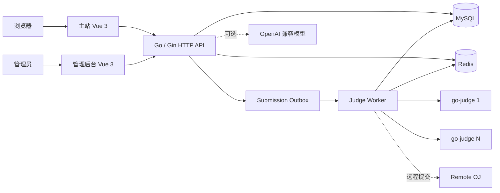

<p align="center">
  
</p>

<h1 align="center">ZeorCode</h1>

<p align="center">
  面向算法教学、在线练习与竞赛组织的一体化在线评测平台
</p>

ZeorCode 将题库、在线代码编辑与评测、比赛、题单、班级作业、学情分析、社区和管理后台整合在同一套系统中。平台使用独立 HTTP 服务与评测 Worker，支持连接多台 [go-judge](https://github.com/criyle/go-judge) 实例，也提供可选的 AI 教学助手，用于理解题目内容并辅助创建作业或题单。

## 核心功能

- **在线练习**：题目检索与标签筛选、Markdown/KaTeX 题面、代码模板、本地草稿、样例与自定义输入测试。
- **异步评测**：提交队列、事务 Outbox、评测 Worker、测试点结果以及多台 go-judge 的轮询和健康检查。
- **比赛系统**：公开与受限比赛、报名、ACM/OI 赛制、实时排名和 Rating 计算。
- **题单系统**：题单简介、题目列表、完成进度和排行榜，已通过题库题目可计入完成状态。
- **班级与作业**：团队成员管理、学生批量导入、作业发布、题单导入、逐题分析和成绩分布。
- **AI 教学助手**：普通对话，以及基于题目正文、标签和难度的作业/题单创建流程；支持 OpenAI 兼容接口。
- **社区与通知**：帖子、评论、点赞、系统广播和站内通知。
- **远程题库**：支持 AtCoder、HDU、LibreOJ 和牛客等远程 OJ 的题目导入与提交适配。
- **管理后台**：用户、题目、题单、比赛、帖子、评测服务、系统通知与操作日志管理。

## 系统架构



HTTP API 负责业务请求、鉴权和提交入队；Judge Worker 独立消费评测任务并调用 go-judge。多个 API、Worker 与 go-judge 实例可以按需横向扩展，共享 MySQL 与 Redis。

## 技术栈

| 模块 | 主要技术 |
| --- | --- |
| 主站 | Vue 3、Vite、Pinia、Vue Router、Element Plus、Tailwind CSS |
| 编辑与展示 | CodeMirror 6、Markdown It、KaTeX、Highlight.js、ECharts |
| 管理后台 | Vue 3、TypeScript、Vite、Element Plus、Pure Admin |
| 后端 | Go、Gin、GORM、Cobra、Viper、Wire、Zap |
| AI | CloudWeGo Eino、OpenAI 兼容 API |
| 数据与队列 | MySQL 8、Redis |
| 评测 | go-judge、多实例负载均衡、异步 Worker、事务 Outbox |
| 自动部署 | GitHub Actions、Nginx、systemd、SSH 发布与失败回滚 |

## 仓库结构

```text
zeorcode/
├── frontend/          # 用户主站
├── admin-frontend/    # 管理后台
├── backend/           # HTTP API、评测 Worker 与数据库定义
│   ├── cmd/           # zeorcode http / judge 子命令
│   ├── database/      # 全量数据库 schema
│   ├── internal/      # handler、service、repository 与基础设施
│   └── pkg/           # 评测、Rating、远程 OJ 等公共包
├── ops/               # 生产发布脚本
└── .github/           # CI/CD 工作流与部署文档
```

## 环境要求

| 依赖 | 建议版本或要求 |
| --- | --- |
| Go | 以 [`backend/go.mod`](./backend/go.mod) 中的版本为准 |
| Node.js | `22.13+` |
| npm | 随 Node.js 安装 |
| pnpm | `10.34.5` |
| MySQL | `8.0+` |
| Redis | `6.0+` |
| go-judge | 启用 HTTP API，并允许后端访问 |

AI 对话是可选功能。未配置模型时，其他业务和确定性的作业创建流程仍可运行。

## Docker Compose 启动

仓库根目录提供多阶段 [`Dockerfile`](./Dockerfile) 和 [`compose.yaml`](./compose.yaml)。Compose 会启动以下服务：

- `web`：Nginx，对外提供主站、`/admin/` 管理后台，并反向代理 `/api/` 与 `/uploads/`。
- `backend-http`：ZeorCode HTTP API。
- `backend-judge`：异步评测 Worker，与 API 共用同一个后端镜像和题目数据卷。
- `mysql`、`redis`：业务数据、会话和评测队列。
- `go-judge`：隔离执行代码的沙箱服务。

先创建本地环境文件并替换其中的密码和密钥：

```bash
cp .env.example .env
```

Windows PowerShell 可使用：

```powershell
Copy-Item .env.example .env
```

然后构建并启动：

```bash
docker compose up -d --build
docker compose ps
```

默认访问地址：

- 主站：`http://localhost:8080`
- 管理后台：`http://localhost:8080/admin/`
- API 调试地址：`http://localhost:9090/api/`（仅绑定宿主机回环地址）
- 容器健康检查：`http://localhost:8080/healthz`

查看 API 和评测日志：

```bash
docker compose logs -f backend-http backend-judge go-judge
```

停止服务但保留数据：

```bash
docker compose down
```

MySQL、Redis、上传文件和本地题目测试数据分别保存在命名卷中。`backend/database/schema.sql` 只会在 MySQL 数据卷首次创建时导入；后续结构升级仍需先备份再执行迁移。`docker compose down -v` 会同时删除这些数据卷，请勿在需要保留数据时使用。

go-judge 按其官方容器运行要求启用了 `privileged` 和 `256m` 共享内存，因此应只在受控主机上运行，不要把 MySQL、Redis 或 go-judge 端口直接暴露到公网。若修改 `WEB_PORT`，还应同步修改 `.env` 中的 `PUBLIC_BASE_URL`，确保上传文件返回正确的公开地址。

需要增加评测 Worker 时，先把 `.env` 中的 `JUDGE_MULTI_INSTANCE` 设为 `true`，再执行 `docker compose up -d --scale backend-judge=2`。多个 Worker 会共享同一套 MySQL、Redis 和题目数据卷。

## 本地启动

### 1. 获取代码

```bash
git clone git@github.com:alonespig/zeorcode.git
cd zeorcode
```

### 2. 初始化 MySQL

创建数据库并导入完整结构。后端不会自动执行 `AutoMigrate`。

```bash
mysql -uroot -p -e "CREATE DATABASE oj_db CHARACTER SET utf8mb4 COLLATE utf8mb4_0900_ai_ci;"
mysql -uroot -p oj_db < backend/database/schema.sql
```

已有环境升级前请先备份数据库，并人工检查、执行对应结构变更。

### 3. 配置后端

```bash
cd backend
cp config.yaml.example config.yaml
```

Windows PowerShell 可使用：

```powershell
Copy-Item config.yaml.example config.yaml
```

至少需要检查以下配置：

- `db`：MySQL 地址、账号、密码和数据库名。
- `redis`：Redis 地址、密码和逻辑库。
- `judge.urls`：一个或多个 go-judge HTTP 地址，本机部署时通常为 `http://127.0.0.1:5050`。
- `jwt.secret`：生产环境必须替换为随机密钥。
- `security.aes_key`：用于加密远程 OJ 凭据，生产环境必须替换。
- `cors.allowed_origins`：需要跨域访问 API 时，加入对应前端来源。

`config.yaml` 已被 Git 忽略，不要提交真实密码、Cookie 或 API Key。

所有标量配置也支持通过 `ZEORCODE_` 前缀的环境变量覆盖，层级中的 `.` 转换为 `_`。例如 `db.host`、`db.pool.max_open_conns` 分别对应 `ZEORCODE_DB_HOST`、`ZEORCODE_DB_POOL_MAX_OPEN_CONNS`；环境变量的优先级高于 `config.yaml`。

### 4. 启动后端 API

```bash
cd backend
go mod download
go run . http
```

默认监听 `http://localhost:9090`。

### 5. 启动评测 Worker

另开终端：

```bash
cd backend
go run . judge
```

可以按机器资源调整并发数：

```bash
go run . judge --concurrency 8
```

API 和 Worker 都依赖 MySQL、Redis；代码运行与本地题评测还要求至少一台可用的 go-judge。

### 6. 启动主站

```bash
cd frontend
npm ci
npm run dev
```

主站默认地址为 `http://localhost:1001`，开发服务器会把 `/api` 和 `/uploads` 代理到 `http://localhost:9090`。

### 7. 启动管理后台

```bash
cd admin-frontend
corepack enable
corepack prepare pnpm@10.34.5 --activate
pnpm install --frozen-lockfile
pnpm dev
```

管理后台默认地址为 `http://localhost:8848`，API 默认代理到 `http://localhost:9090`。

## AI 助手配置

在 `backend/config.yaml` 中启用：

```yaml
ai:
  enabled: true
  base_url: "https://api.openai.com/v1"
  model: "your-model"
  api_key: ""
  request_timeout_seconds: 60
  max_output_tokens: 2048
```

建议通过环境变量提供敏感配置：

| 环境变量 | 作用 |
| --- | --- |
| `ZEORCODE_AI_API_KEY` | 模型 API Key |
| `ZEORCODE_AI_MODEL` | 模型名称 |
| `ZEORCODE_AI_BASE_URL` | OpenAI 兼容接口地址 |

环境变量优先于 `config.yaml` 中的对应 AI 配置。

## 常用开发命令

### 后端

```bash
cd backend
go fmt ./...
go test ./...
go build -o zeorcode .
```

需要 MySQL 的集成测试默认不会参与普通测试。运行时设置 `ZEORCODE_TEST_MYSQL_DSN`，并确保测试账号具备所需的建库或临时表权限：

```bash
go test -tags=integration ./...
```

### 主站

```bash
cd frontend
npm run build
npm run lint
```

### 管理后台

```bash
cd admin-frontend
pnpm typecheck
pnpm build
pnpm lint
```

两个前端的 lint 命令都可能自动格式化或修复文件，运行后请检查 Git diff。

## 生产部署

推送到 `main` 后，[`deploy.yml`](./.github/workflows/deploy.yml) 会依次执行后端测试、Linux 后端构建、主站构建、管理后台构建和 SSH 发布。服务器脚本支持发布失败时恢复上一版后端与静态文件。

当 `backend/database` 发生变化时，自动部署会主动停止。完成数据库备份、迁移和验证后，再从 GitHub Actions 手动运行部署工作流。首次安装、Secrets、Nginx 和 systemd 配置见 [GitHub Actions 自动部署说明](./.github/AUTOMATIC_DEPLOYMENT.md)。

当前生产服务器仍沿用 `/opt/zoj`、`/var/www/zoj`、`zoj-http.service` 和 `zoj-judge.service` 等历史运行标识；应用模块、CLI 和新发布包内的二进制已经统一为 `ZeorCode` / `zeorcode`。部署脚本会处理这一兼容关系。

## 数据与安全

- 不要提交 `backend/config.yaml`、模型密钥、远程 OJ Cookie、数据库备份或用户上传文件。
- 修改 `backend/database` 前先准备可回滚的数据库备份，并在测试环境验证 SQL。
- 生产环境应为 MySQL、Redis 和 go-judge 设置网络访问边界，不应直接暴露到公网。
- `jwt.secret` 与 `security.aes_key` 必须使用独立的高强度随机值。
- 多实例部署时，需要按实例总数规划 MySQL 连接池和评测并发，并让所有服务连接同一套 MySQL 与 Redis。

## 文档

- [后端命令说明](./backend/README.md)
- [自动部署说明](./.github/AUTOMATIC_DEPLOYMENT.md)

## License

仓库根目录目前尚未声明统一的开源许可证。对外分发或接受外部贡献前，请先补充适用于整个项目的 `LICENSE`。
